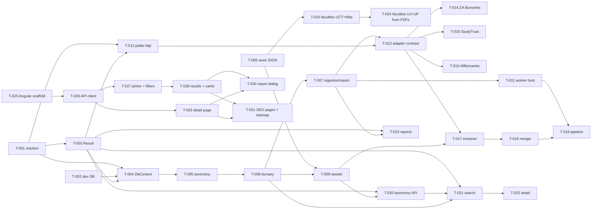

# Tasks

Each `T-xxx-*.md` file is **one unit of work for one implementer agent = one PR**. Files are the source of truth and are mirrored to GitHub Issues by `node scripts/sync-issues.mjs`. The workflow is described in [specs/04-agent-workflow.md](../specs/04-agent-workflow.md). New tasks start from [`_TEMPLATE.md`](_TEMPLATE.md).

## Commands
```bash
node scripts/sync-issues.mjs --check   # validate all task files (CI runs this)
node scripts/sync-issues.mjs --ready   # which tasks can start now?
node scripts/sync-issues.mjs           # create/update GitHub Issues + labels (needs gh auth)
```
To start a task, add the **`agent:ready`** label to its issue. Do this only when every `depends_on` task is merged.

## Phase plan

| Phase | Theme | Status |
|---|---|---|
| **0** | Foundation: solution, CI, dev DB, `Result<T>`, DbContext | Detailed (T-001–T-004) |
| **1** | Data model & reference data | Detailed (T-005–T-010) |
| **2** | Ingestion worker: HTTP, adapters, extraction, dedupe | Detailed (T-011–T-019) |
| **3** | Public read API: taxonomy, search, detail, reports | Detailed (T-020–T-023) |
| **4** | Angular web app: SSR scaffold, API client, degree picker + filters, results, detail, report dialog, SEO pages | Detailed (T-025–T-031) |
| 5 | Accounts (Identity + Google), sign-in prompt, saved bursaries + tracker, admin review queue, source and taxonomy management | Roadmap; detailed when Phase 3 lands |
| 6 | Launch: VPS deploy (Docker Compose + Caddy), ads + consent, privacy policy, monitoring, budget alerts | Roadmap |

## Dependency graph (Phases 0–4)



**Can start immediately (in parallel):** T-001, T-002, T-008.

> Parallel adapter tasks (T-014–T-016) each add one line to `Worker/Program.cs` and `sources.json`. Expect a trivial rebase when merging the second and third.
